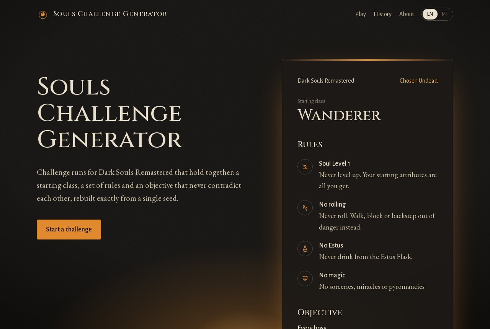
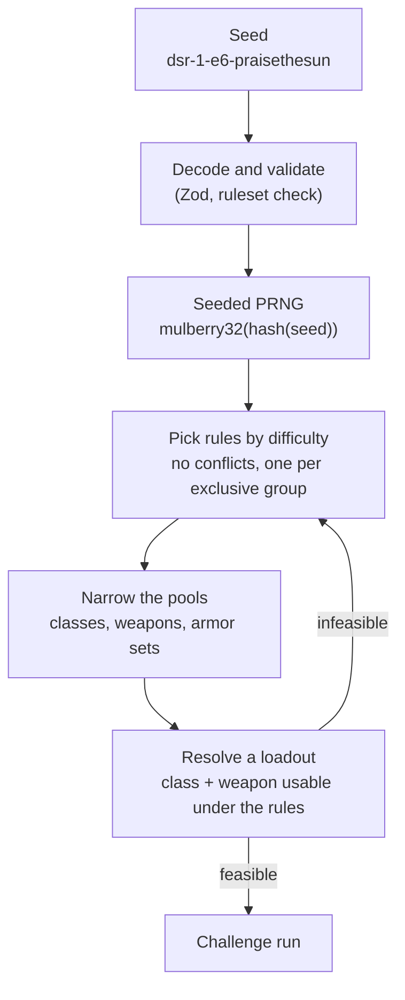

🇺🇸 English | [🇧🇷 Português](README.pt-BR.md)

# Souls Challenge Generator

[](https://github.com/localhost-ayu/souls-challenge-generator/actions/workflows/ci.yml)
[](LICENSE)
[](https://souls.grazzioli.dev)

Challenge runs for Dark Souls Remastered that hold together: a starting class, a set of rules and
an objective that never contradict each other, rebuilt exactly from a single seed.
Made by a fan, for fans.

**Live site:** https://souls.grazzioli.dev



## Features

- **Coherent runs.** Conflicting rules never appear together, and picks respect the rest of the
  run: under Soul Level 1, the weapon is always usable with the class's starting attributes.
- **Reproducible seeds.** A short, URL-safe seed such as `dsr-1-e6-praisethesun` rebuilds the same
  run on any device. Share the seed or a link.
- **Your difficulty, or luck.** Pick Hollow to Lord of Cinder, the objective (required bosses or
  every boss, with or without the DLC) and the kinds of rules allowed, or press _I'm feeling lucky_.
- **English and Portuguese**, switched instantly without reloading.
- **History and favorites**, kept in your browser. No account, no backend.

## How it works

Everything a run needs lives in its seed: `<game>-<ruleset>-<preferences>-<key>`.

- `ruleset` changes whenever the data or the algorithm changes, so an old seed is rejected with an
  explanation instead of silently producing a different run.
- `preferences` packs difficulty, objective, DLC and allowed rule types into two characters.
- `key` is the randomness. Any word works, so `praisethesun` is a valid key.



When a combination has no valid loadout (for example, Soul Level 1 + bows only + starting as the
Deprived, who lacks the Dexterity for any bow), the generator tries again with the same random
sequence. The retry is therefore deterministic too. The tests generate 20,000 runs and check every
rule on each of them.

## Architecture

- **A pure TypeScript engine** (`src/engine`). No React, Next.js or browser APIs, enforced by an
  ESLint rule. The core knows nothing about Dark Souls: each game is a module (dataset, rules and a
  resolver) in a registry, so adding a game does not touch the core.
- **Data and rules are separate.** JSON describes the game world (classes, weapons, armor, bosses);
  constraint definitions describe the challenges. Every boundary (dataset, seed, local storage) is
  validated with Zod.
- **A fully static site.** Next.js with `output: "export"`. Runs are generated in the browser from
  the `?seed=` query string, so any static host can serve it.
- **Client-side i18n.** Translation keys are typed from the English dictionary, so a missing key
  fails the type check. Game names stay as in the game; only the interface is translated.

**Stack:** Next.js 16, React 19, TypeScript (strict), Tailwind CSS 4, Zod, Vitest and Testing
Library, deployed on Vercel with GitHub Actions for CI.

## Running locally

Requires Node.js 22 (see `.nvmrc`).

```bash
npm install
npm run dev
```

| Script | Description |
| --- | --- |
| `npm run dev` | Start the development server |
| `npm run build` | Build the static site into `out/` |
| `npm run lint` | Run ESLint |
| `npm run typecheck` | Type-check the project |
| `npm test` | Run the unit and component tests |
| `npm run test:watch` | Run the tests in watch mode |

To preview the production build, serve the `out/` folder with any static server, for example
`npx serve out`.

## Project structure

```
src/
├── app/              Routes: /, /play, /run, /history, /about, plus metadata files
├── components/       UI, grouped by page (run, play, history, layout, ui)
├── engine/
│   ├── core/         Game-agnostic types, PRNG, seeds, compatibility and generator
│   ├── games/
│   │   ├── registry.ts
│   │   └── dsr/      Dark Souls Remastered: dataset, schema and constraints
│   └── index.ts      Public API: generateRun, createSeed, parseSeed…
├── i18n/             Provider, typed keys and the en-US / pt-BR dictionaries
└── lib/storage/      Versioned, validated local storage
```

## Roadmap

- More games: Dark Souls II, Dark Souls III, Bloodborne, Elden Ring and Shadow of the Erdtree.
- More rules and objectives for Dark Souls Remastered.
- A visual redesign of the interface.

## Data

Game data holds facts only (names, numbers, categories), gathered from community wikis and
cross-checked. See [docs/DATA_SOURCES.md](docs/DATA_SOURCES.md).

## Disclaimer

Souls Challenge Generator is an unofficial, non-commercial fan project, made by a fan for fans.
It is not affiliated with, endorsed, sponsored, or approved by FromSoftware, Inc. or
Bandai Namco Entertainment Inc. Dark Souls and all related names, characters, and game content
are trademarks and/or copyrighted material of their respective owners. No official game assets
are used in this project.

## Credits

**Nathã Grazzioli Botelho**
- GitHub: [localhost-ayu](https://github.com/localhost-ayu)
- Portfolio: [grazzioli.dev](https://grazzioli.dev)

Fonts: [Cinzel](https://fonts.google.com/specimen/Cinzel),
[EB Garamond](https://fonts.google.com/specimen/EB+Garamond) and
[Alegreya Sans](https://fonts.google.com/specimen/Alegreya+Sans), under the SIL Open Font License.
Icons and illustrations are original to this project.

## License

[MIT](LICENSE). The license covers only the original code and assets of this project.
