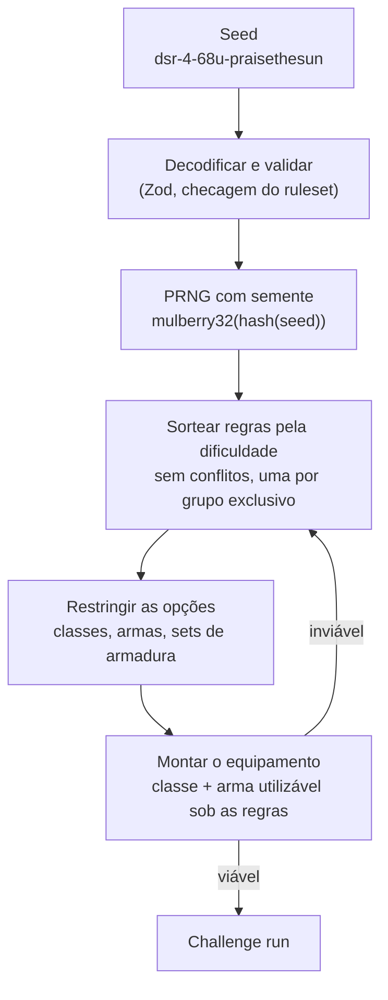

[🇺🇸 English](README.md) | 🇧🇷 Português

# Souls Challenge Generator

[](https://github.com/localhost-ayu/souls-challenge-generator/actions/workflows/ci.yml)
[](LICENSE)
[](https://souls.grazzioli.dev)

Challenge runs de Dark Souls Remastered que fazem sentido: uma classe inicial, um conjunto de
regras e um objetivo que nunca se contradizem, recriados com exatidão a partir de uma única seed.
Feito de fã para fã.

**Site:** https://souls.grazzioli.dev


## Funcionalidades

- **Runs coerentes.** Regras conflitantes nunca aparecem juntas, e as escolhas respeitam o resto da
  run: em Soul Level 1, a arma sempre pode ser usada com os atributos iniciais da classe.
- **Seeds reproduzíveis.** Uma seed curta e segura para URL, como `dsr-4-68u-praisethesun`, recria a
  mesma run em qualquer dispositivo. Compartilhe a seed ou um link.
- **Sua dificuldade, ou a sorte.** Escolha de Hollow a Lorde das Cinzas, o objetivo (bosses
  obrigatórios ou todos, com ou sem o DLC) e os tipos de regra permitidos, ou clique em
  _Estou com sorte_.
- **Português e inglês**, com troca instantânea e sem recarregar.
- **Regras da casa em toda carta.** Buffs, invocações e glitches aparecem como permitidos ou
  proibidos, para nenhuma run deixar isso em aberto.
- **Histórico e favoritos** guardados no seu navegador. Sem conta e sem backend.

## Como funciona

Tudo o que uma run precisa está na seed: `<jogo>-<ruleset>-<preferências>-<chave>`.

- `ruleset` muda sempre que os dados ou o algoritmo mudam. Assim, uma seed antiga é recusada com
  uma explicação, em vez de gerar outra run sem avisar.
- `preferências` guarda dificuldade, objetivo, DLC, regras da casa e tipos de regra em três
  caracteres.
- `chave` é a aleatoriedade. Qualquer palavra serve, então `praisethesun` é uma chave válida.



Quando uma combinação não tem equipamento válido, o gerador tenta de novo com a mesma sequência
aleatória, então a nova tentativa também é determinística. Um exemplo é Soul Level 1 + só arcos +
começar como Deprived, que não tem Destreza para nenhum arco. Os testes geram 20.000 runs e
conferem todas as regras em cada uma.

## Arquitetura

- **Engine em TypeScript puro** (`src/engine`). Sem React, Next.js ou APIs do navegador, o que é
  garantido por uma regra de ESLint. O núcleo não sabe nada de Dark Souls: cada jogo é um módulo
  (dados, regras e resolvedor) num registro, então adicionar um jogo não mexe no núcleo.
- **Dados separados das regras.** O JSON descreve o mundo do jogo (classes, armas, armaduras,
  bosses); as definições de constraint descrevem os desafios. Toda fronteira (dados, seed,
  armazenamento local) é validada com Zod.
- **Site 100% estático.** Next.js com `output: "export"`. As runs são geradas no navegador a partir
  da query `?seed=`, então qualquer hospedagem estática serve o site.
- **i18n no cliente.** As chaves de tradução são tipadas a partir do dicionário em inglês, então
  uma chave faltando quebra a checagem de tipos. Nomes do jogo ficam como no jogo; só a interface é
  traduzida.

**Stack:** Next.js 16, React 19, TypeScript (strict), Tailwind CSS 4, Zod, Vitest e Testing
Library, com deploy na Vercel e CI no GitHub Actions.

## Rodando localmente

Requer Node.js 22 (veja `.nvmrc`).

```bash
npm install
npm run dev
```

| Script | Descrição |
| --- | --- |
| `npm run dev` | Inicia o servidor de desenvolvimento |
| `npm run build` | Gera o site estático em `out/` |
| `npm run lint` | Roda o ESLint |
| `npm run typecheck` | Checa os tipos do projeto |
| `npm test` | Roda os testes unitários e de componente |
| `npm run test:watch` | Roda os testes em modo watch |

Para ver o build de produção, sirva a pasta `out/` com qualquer servidor estático, por exemplo
`npx serve out`.

## Estrutura de pastas

```
src/
├── app/              Rotas: /, /play, /run, /history, /about e arquivos de metadata
├── components/       Interface, agrupada por página (run, play, history, layout, ui)
├── engine/
│   ├── core/         Tipos genéricos, PRNG, seeds, compatibilidade e gerador
│   ├── games/
│   │   ├── registry.ts
│   │   └── dsr/      Dark Souls Remastered: dados, schema e constraints
│   └── index.ts      API pública: generateRun, createSeed, parseSeed…
├── i18n/             Provider, chaves tipadas e os dicionários en-US / pt-BR
└── lib/storage/      Armazenamento local versionado e validado
```

## Roadmap

- Mais jogos: Dark Souls II, Dark Souls III, Bloodborne, Elden Ring e Shadow of the Erdtree.
- Mais regras e objetivos para Dark Souls Remastered.
- Um redesign visual da interface.

## Dados

Os dados do jogo são apenas fatos (nomes, números, categorias), reunidos de wikis da comunidade e
conferidos entre fontes. Veja [docs/DATA_SOURCES.md](docs/DATA_SOURCES.md).

## Aviso legal

Souls Challenge Generator é um projeto não oficial e sem fins comerciais, feito de fã para fã.
Não possui afiliação, endosso, patrocínio ou aprovação da FromSoftware, Inc. ou da
Bandai Namco Entertainment Inc. Dark Souls e todos os nomes, personagens e conteúdos relacionados
são marcas registradas e/ou material protegido por direitos autorais de seus respectivos donos.
Nenhum asset oficial dos jogos é utilizado neste projeto.

## Créditos

**Nathã Grazzioli Botelho**
- GitHub: [localhost-ayu](https://github.com/localhost-ayu)
- Portfólio: [grazzioli.dev](https://grazzioli.dev)

Fontes: [Cinzel](https://fonts.google.com/specimen/Cinzel),
[EB Garamond](https://fonts.google.com/specimen/EB+Garamond) e
[Alegreya Sans](https://fonts.google.com/specimen/Alegreya+Sans), sob a SIL Open Font License.
Ícones e ilustrações são originais deste projeto.

## Licença

[MIT](LICENSE). A licença cobre apenas o código e os assets originais deste projeto.
